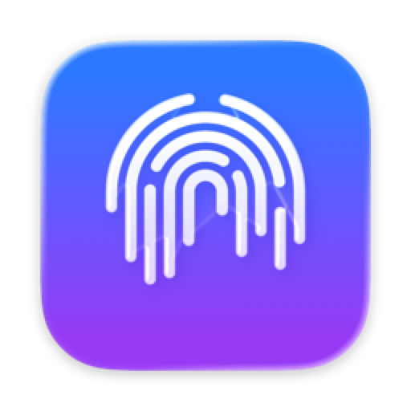
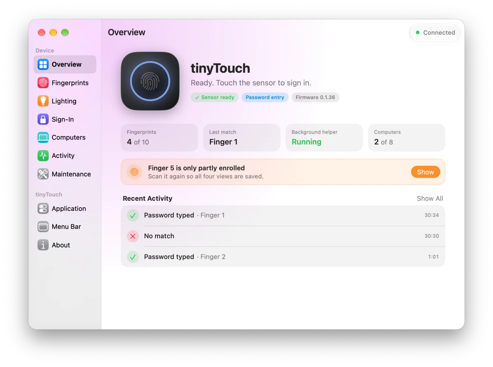
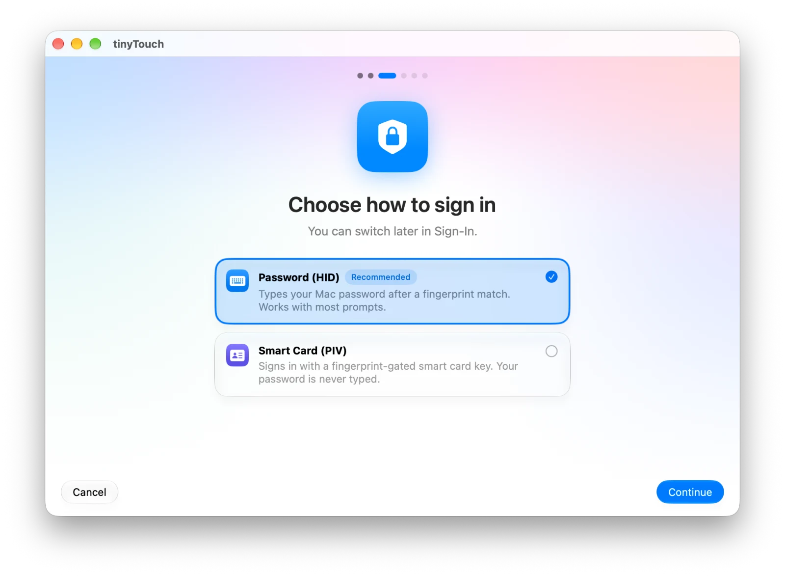
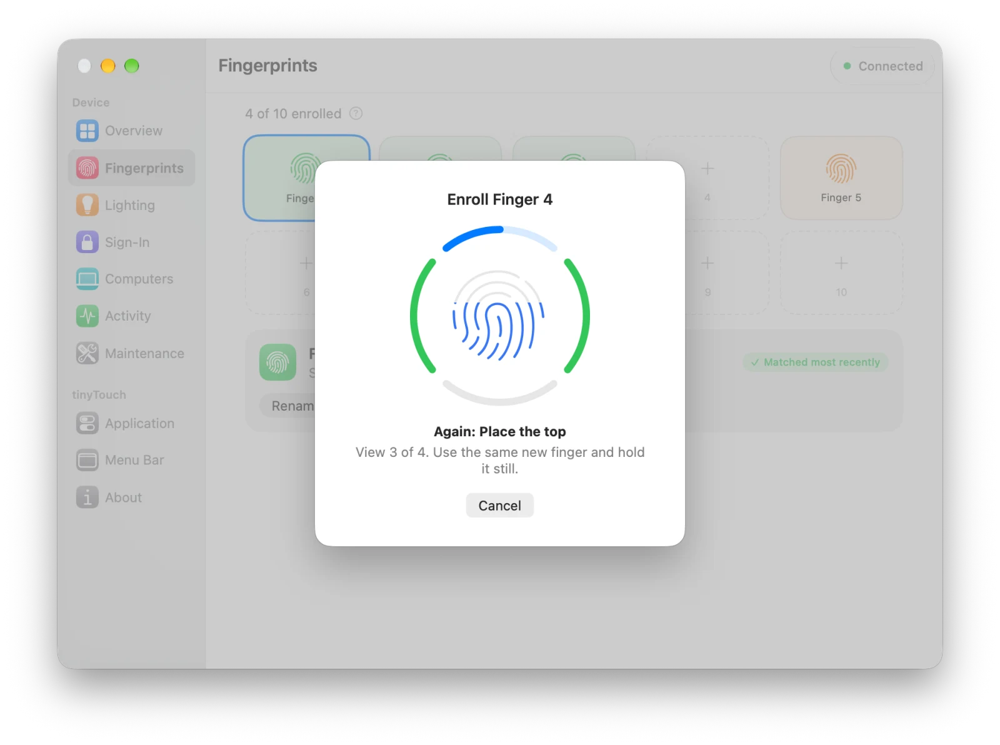
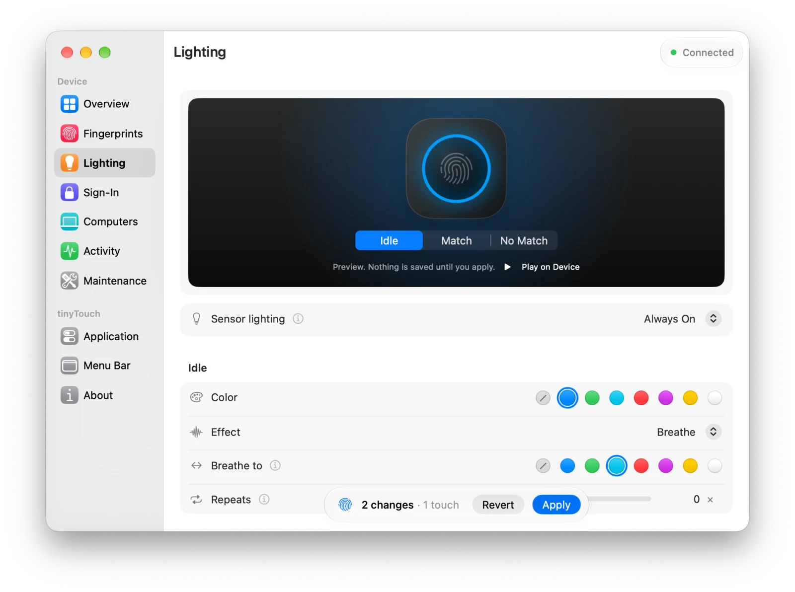
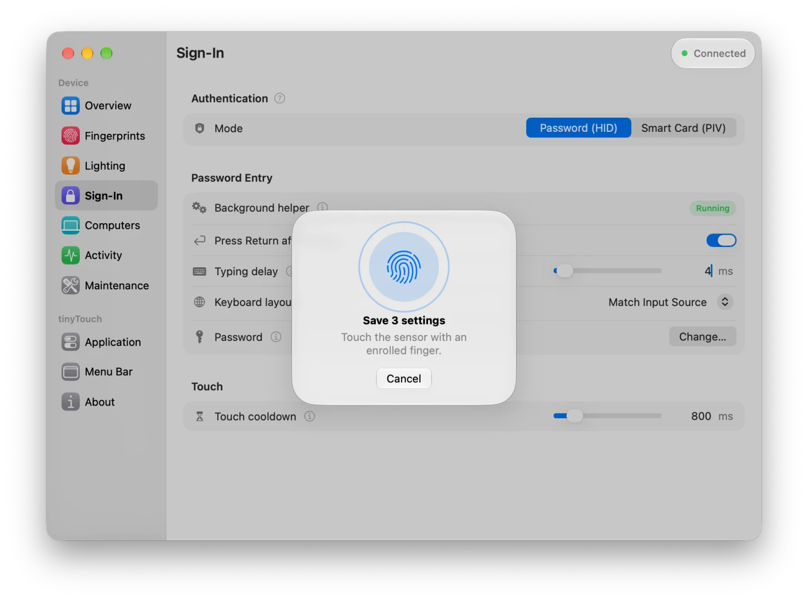
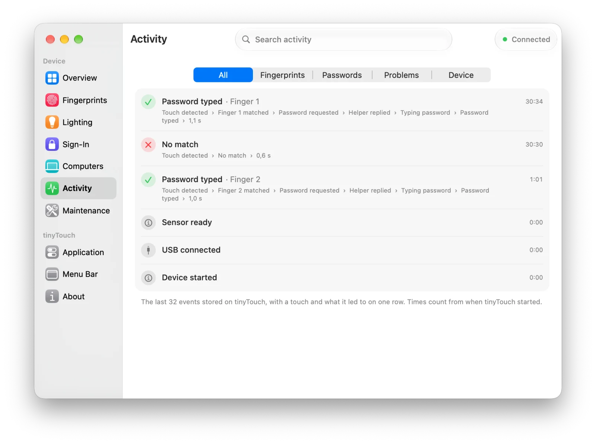

<div align="center">



# tinyTouch for macOS

**Touch to sign in. A native Mac app for the tinyTouch fingerprint key.**

Set up, tune and keep an eye on your [tinyTouch](https://github.com/ZimengXiong/tinyTouch)
without ever opening Terminal.


[](LICENSE)

<br>

<picture>
  <source media="(prefers-color-scheme: dark)" srcset="docs/images/overview-dark.webp">
  
</picture>

</div>

tinyTouch is an open-source fingerprint device by Zimeng Xiong. Touch the sensor and
it types your Mac password, or signs you in as a smart card. This app is its home on
the Mac: a guided setup, every device setting in one window, and a menu bar item that
tells you it's ready. It carries its own signed copy of the `tinytouch` CLI, so there
is nothing else to install.

## Highlights

<table>
<tr>
<td width="50%" valign="top">

### Set up in a few minutes

Connect tinyTouch, pick password entry or smart card, enroll a finger. The app checks
your password against your macOS account before it saves it.

</td>
<td width="50%">

<picture>
  <source media="(prefers-color-scheme: dark)" srcset="docs/images/setup-dark.webp">
  
</picture>

</td>
</tr>
<tr>
<td width="50%">

<picture>
  <source media="(prefers-color-scheme: dark)" srcset="docs/images/enroll-dark.webp">
  
</picture>

</td>
<td width="50%" valign="top">

### Enroll with guidance

A ring fills in as each view is scanned, with plain instructions for where to place
your finger next. Name your fingers so you know which is which.

</td>
</tr>
<tr>
<td width="50%" valign="top">

### Make the light yours

Choose the idle, match and no-match colors and effects, preview them live, and play
them on the device before you save.

</td>
<td width="50%">

<picture>
  <source media="(prefers-color-scheme: dark)" srcset="docs/images/lighting-dark.webp">
  
</picture>

</td>
</tr>
<tr>
<td width="50%">

<picture>
  <source media="(prefers-color-scheme: dark)" srcset="docs/images/prompt-dark.webp">
  
</picture>

</td>
<td width="50%" valign="top">

### One touch saves it all

Changes wait in a floating Apply bar. When you're done, one touch on the sensor
saves every one of them.

</td>
</tr>
<tr>
<td width="50%" valign="top">

### See every touch

Activity shows each touch and what it led to, from match to typed password, with
search and filters.

</td>
<td width="50%">

<picture>
  <source media="(prefers-color-scheme: dark)" srcset="docs/images/activity-dark.webp">
  
</picture>

</td>
</tr>
</table>

### And more

- **Menu bar status.** See the mode, enrolled fingers and helper state at a glance,
  and jump to the tab you need.
- **Several Macs.** Name the computers registered on your tinyTouch and remove the
  ones you no longer use.
- **Works in the background.** Password entry keeps working with the window closed;
  the background helper runs on its own.
- **The CLI included.** Add the `tinytouch` command to your shell from the Application
  settings. It
  runs the copy inside the app, so it updates with the app.

## Get started

There is no prebuilt download yet. With Xcode 27 and `uv` installed:

```sh
git clone --recurse-submodules https://github.com/tarakanof/tinyTouch-mac.git
cd tinyTouch-mac
TINYTOUCH_PYTHON="$(uv python find --managed-python 3.13)" ./build-app.sh
cp -R dist/tinyTouch.app /Applications/
```

Then open tinyTouch and follow the setup. The app does not change the firmware:
build, flash and update the device as upstream describes in its
[setup guide](https://docs.tinytouch.dev/customer/setup).

## Documentation

- [Building](docs/building.md): requirements, signing, the CLI submodule and the
  bundle layout.
- [Using the app](docs/using.md): setup, saving changes, names, the background helper.
- [Development](docs/development.md): tests, demo mode and screenshots.

## About

tinyTouch for macOS is an independent project by Dmitrii Tarakanov and is not part of
upstream [tinyTouch](https://github.com/ZimengXiong/tinyTouch). Released under the
[MIT License](LICENSE).
